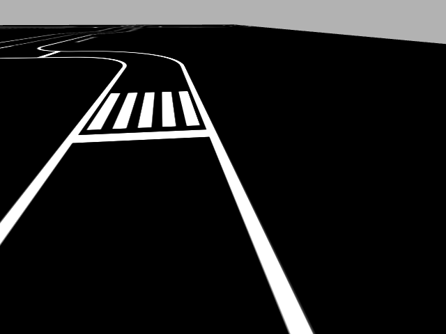

# Adas-lane-keeping-system
Hệ thống ADAS hỗ trợ giữ làn đường kết hợp mô phỏng Gazebo và xe tự hành thực tế

## Mô phỏng ADAS

Mã mô phỏng ADAS hỗ trợ giữ làn bằng OpenCV, chạy trên ROS 2 Jazzy và Gazebo Harmonic, nằm trong [`simulation/`](simulation/README.md).

Xem [hướng dẫn cài đặt, build và chạy](simulation/README.md) để khởi động mô phỏng và giao diện điều khiển. Thực hiện build trong `simulation/`.

Không kèm trọng số AI (`best.pt`, `*.pt`), dataset hoặc dữ liệu huấn luyện. Chế độ mặc định `geometry` không cần trọng số AI.

Nguồn mô phỏng và giấy phép được ghi trong [README mô phỏng](simulation/README.md#nguồn-gốc) và [LICENSE](simulation/LICENSE).

## Ảnh và video demo

Ảnh camera gốc trong mô phỏng, chưa phủ kết quả nhận diện.
Xem [thư viện media](media/README.md) và [danh sách video](media/videos/README.md).

## Model AI sau này

Đặt trọng số tại `models/best.pt`. Xem [hướng dẫn model và lệnh chạy](models/README.md).
Chế độ OpenCV hiện tại không cần file này; model và dữ liệu huấn luyện chưa được tải lên repo.
