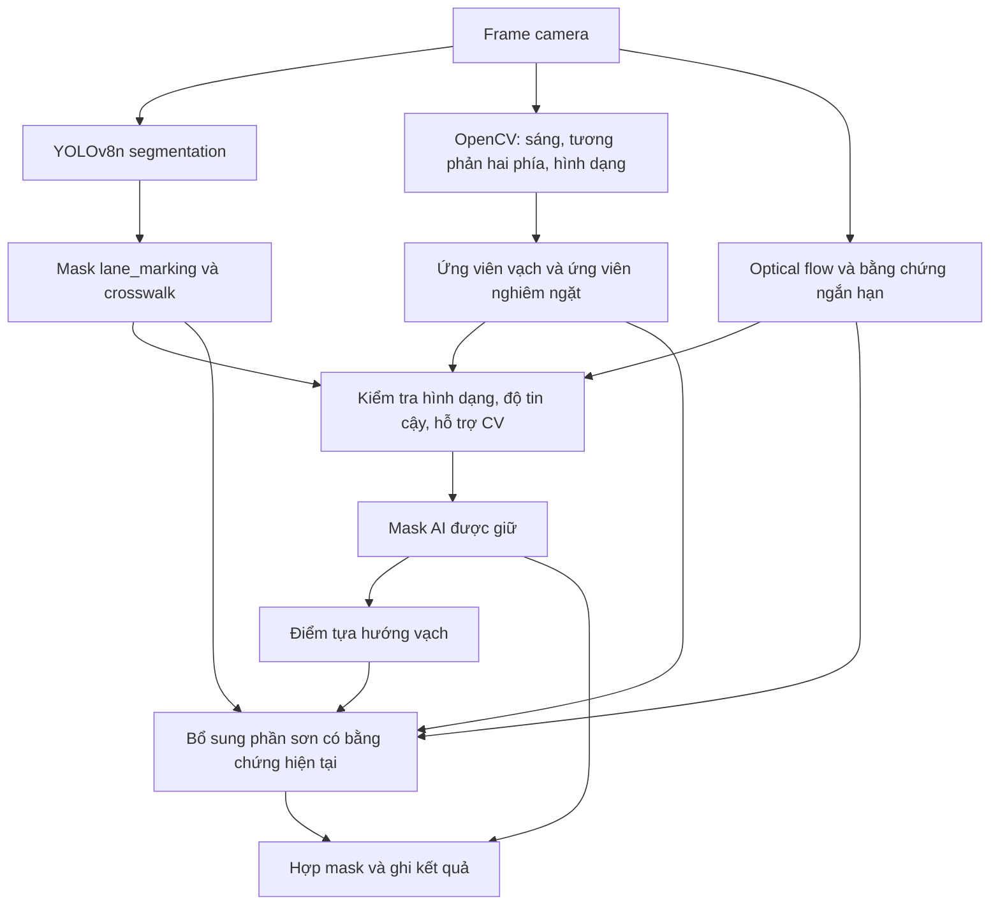

# Thuật toán nhận diện vạch đường: AI + OpenCV, bản thử nghiệm v3

## Mục tiêu và đầu ra hiện tại

Đầu vào là frame BGR từ video camera. AI cung cấp ngữ nghĩa `lane_marking` và `crosswalk`; OpenCV cung cấp bằng chứng cục bộ về dải sơn sáng. Đầu ra là **mask các phần vạch đường nhìn thấy**, chưa phải hai biên làn đang đi, tim đường hoặc góc lái.

Mã thực thi: [hybrid_video.py](../src/perception/hybrid_video.py). Đây là heuristic fusion, chưa được chứng minh luôn tốt hơn AI riêng hoặc CV riêng.

## 1. Bằng chứng AI

YOLO chạy `imgsz=640`, confidence đầu vào 0.25, `retina_masks=True`. Các instance cùng lớp được hợp bằng phép max. Mỗi pixel thuộc mask nhận confidence của **instance**, không phải xác suất phân loại pixel đã hiệu chuẩn.

Loại vùng trên ROI (mặc định y < 0.4H). Thành phần AI có ít nhất 8 pixel được xét nếu chiều cao ≥5 và diện tích/chiều cao <0.1W. Giữ khi ít nhất một điều kiện đúng:

- Confidence cao nhất trong thành phần ≥0.35.
- Ít nhất 25% mask được CV hỗ trợ trong vùng giãn 5×5.
- Ít nhất 40% mask trùng bằng chứng frame trước sau bù chuyển động.

Nếu CV hỗ trợ ≥80%, thu hẹp mask AI vào vùng CV đã giãn. Nếu CV yếu, vẫn có thể giữ AI: tránh xóa sạch dự đoán khi ảnh mờ hoặc vạch ít tương phản. Nhược điểm là AI sai nhưng confidence cao vẫn có thể lọt qua.

## 2. Ứng viên OpenCV

Đổi grayscale và HSV; làm mượt Gaussian 3×3. Với mỗi bán kính r ∈ {3,5,8,12,18,25}, xét độ sáng của pixel so với hai phía ngang:

`ridge_r(x,y) = min(I(x,y) − I(x−r,y), I(x,y) − I(x+r,y))`

Lấy giá trị lớn nhất qua các r. Pixel ứng viên cần contrast >14, saturation <90, grayscale >95, nằm trong ROI. Morphological opening 2×2 loại nhiễu; **không closing để nối kín khoảng đứt**.

Lọc thành phần liên thông theo diện tích, chiều cao, tỷ lệ dài/rộng và độ dày. Tập nghiêm ngặt yêu cầu tỷ lệ dài/rộng ≥2.3, chiều cao ≥10, solidity ≥0.90, occupancy ≥0.75 và median contrast >19. Định nghĩa solidity/occupancy và chi tiết ngưỡng nằm trong hàm `cv_mask`.

Phép đo hai phía ngang thuận lợi cho vạch dọc trong phối cảnh; vạch gần ngang, cua gắt, bóng gắt hoặc phản chiếu vẫn có thể bị bỏ sót/nhầm.

## 3. Bù chuyển động và lịch sử

Farneback optical flow chạy ở nửa độ phân giải, hướng từ frame hiện tại về frame trước để remap mask, bộ đếm và điểm tựa. Chỉ dùng lịch sử nếu khoảng thời gian nguồn nằm trong (0, 0.2] giây, kích thước không đổi và chênh sáng sau remap <35.

Bộ đếm tồn tại chỉ tăng tại pixel CV nghiêm ngặt **đang hiện diện**, tối đa 5. Điểm tựa AI hết hạn sau 0.25 giây nguồn. Timestamp đảo chiều/nhảy quá xa không dùng lịch sử. Timestamp lấy từ chỉ số frame/FPS, không phải thời gian máy tính xử lý.

## 4. Bổ sung CV có kiểm soát

Không lấy hợp toàn bộ AI và CV, vì nền bóng cũng tạo dải sáng.

- Gần AI: nếu ≥20% thành phần CV chạm vùng giãn AI 17×17, chỉ thêm các pixel CV trong vùng đó.
- Xa AI: cần phù hợp hướng/vị trí điểm tựa AI còn mới, hoặc chuỗi ít nhất ba đoạn đứt riêng biệt thẳng hàng đã tồn tại đủ lâu.
- Với nhánh tồn tại: ≥65% vùng có bộ đếm ít nhất 3 frame; chuỗi đoạn đứt cần phủ ≥65% vùng nếu không có điểm tựa.
- Có điểm tựa phù hợp thì CV nghiêm ngặt có thể bù phần AI thiếu ngay, không cần chờ ba frame.
- Nếu crosswalk confidence ≥0.55 phủ quá nửa ứng viên và ít chạm AI làn, không thêm thành phần CV đó.

Điểm tựa được dựng từ AI được chấp nhận và AI cũ còn hạn; **CV bổ sung không tự trở thành điểm tựa**. Hàm fit x(y) bậc 1/2 chỉ kiểm tra hướng và khoảng cách, không tô đường giả, không dùng làm góc lái. Vùng bổ sung phải có pixel CV của frame hiện tại. Mask cuối: `accepted_AI OR accepted_current_CV`.

## 5. Chưa làm trong bản này

Chưa chọn đúng cặp biên của làn xe đang đi tại ngã tư; chưa hiệu chuẩn camera/biến đổi mặt phẳng đường; chưa ước lượng lệch tâm và sai số hướng; chưa có điều khiển xe thật hay tự giảm tốc bằng crosswalk. Nhãn crosswalk từng thanh và cả vùng còn lẫn nhau. Không được dùng lượng pixel hoặc tỷ lệ frame có nhãn làm “độ chính xác”.

Bước tiếp theo là lấy tập video kiểm thử độc lập, chỉnh nhãn, so AI/CV/hybrid trên cùng frame và đo trên Pi trước khi nối bộ chấp hành. Thiết kế tích hợp: [ARCHITECTURE](ARCHITECTURE.md).
