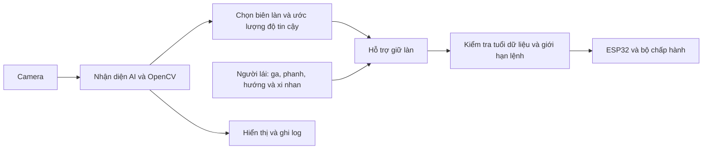

# Kiến trúc ADAS xe thật và phạm vi triển khai

Dự án hướng tới Raspberry Pi 5 8GB, camera và bộ điều khiển chấp hành ESP32. ROS 2 dùng để tổ chức luồng dữ liệu; OpenCV là thư viện xử lý ảnh bên trong thành phần nhận diện. Hai công nghệ bổ sung nhau.

| Thành phần | Trạng thái hiện tại |
|---|---|
| YOLOv8n-seg hai lớp | Đã train pilot; chất lượng còn hạn chế |
| AI-only và hybrid trên video thật | Có code, lưu toàn bộ kết quả và log |
| Mask v3 có lọc phản chiếu | Có code, kiểm tra tổng hợp và một số đoạn video |
| Chọn cặp biên làn, tim đường trên xe thật | Cần phát triển và kiểm chứng |
| ROS 2 camera/perception/control xe thật | Thiết kế dự kiến; chưa có node triển khai trong src |
| ESP32, giao tiếp và xi nhan xe thật | Chưa cung cấp firmware, pinout hay giao thức đã kiểm thử |
| ADAS hình học trong Gazebo | Có bản riêng tại simulation; không đồng nghĩa đã chạy trên xe thật |

## Luồng dự kiến cho xe thật — chưa phải các node đang hoạt động

Người lái quyết định tốc độ/phanh/hướng. Xi nhan thể hiện ý định, không tự chứng minh làn bên cạnh trống hoặc cho phép tự chuyển làn. Crosswalk mới là tín hiệu nhận biết cần thận trọng; logic giảm tốc phải được thiết kế và kiểm thử riêng.

Khi triển khai cần thống nhất timestamp, hệ tọa độ, kiểu thông điệp, giới hạn góc/tốc độ thay đổi góc và cách trả quyền cho người lái. Khi ảnh quá cũ hoặc không có biên đáng tin, ngừng phát hiệu chỉnh tự động; không kéo dài vô hạn kết quả frame trước. Ngưỡng thời gian và lệnh phải được đo theo phần cứng thật.

Không sao chép trực tiếp gain, ROI hay đơn vị lệnh tốc độ từ Gazebo sang xe thật. Tham số `--speed 0.06` của bản mô phỏng không phải phép đo vận tốc xe thật.

## Phân chia repository

- `src/perception/`: thử nhận diện video thật hiện tại.
- `training/`: notebook huấn luyện pilot.
- `models/`: nơi đặt trọng số cục bộ và thông tin model.
- `data/`: mô tả dữ liệu; không phát hành dataset trong repo.
- `simulation/`: toàn bộ code, tài liệu và media Gazebo.
- `hardware/`, `media/`: nhóm bổ sung linh kiện, sơ đồ, hình ảnh và video xe thật.
