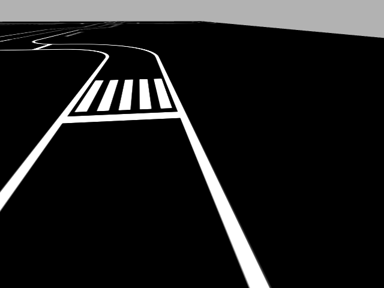

# Ảnh và video minh họa

- `images/`: ảnh demo Gazebo, giao diện ADAS và xe thật. Chỉ dùng ảnh đã chọn để giới thiệu dự án.
- `videos/README.md`: danh sách liên kết video demo.
- Dataset huấn luyện thuộc `data/`, không đặt ở đây.

## Camera Gazebo

Ảnh camera gốc từ clip mô phỏng ngày 31/10/2026; không phải kết quả nhận diện AI hoặc bằng chứng chất lượng giữ làn.

Video ghi từ giao diện ADAS được lưu cục bộ trong `simulation/basic_autonomy/predictions/adas/clips/` khi chạy từ repo này. R bắt đầu ghi, T kết thúc clip. Chọn đoạn cần trình bày rồi tải lên Drive/YouTube và thêm liên kết vào danh sách video.
