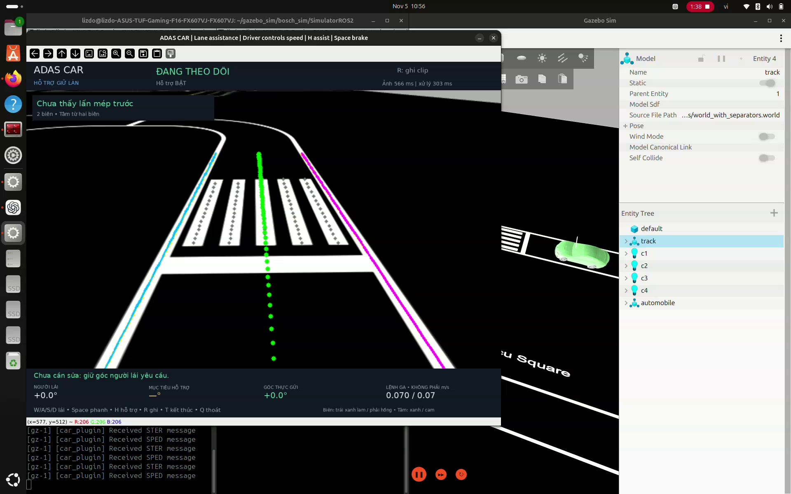
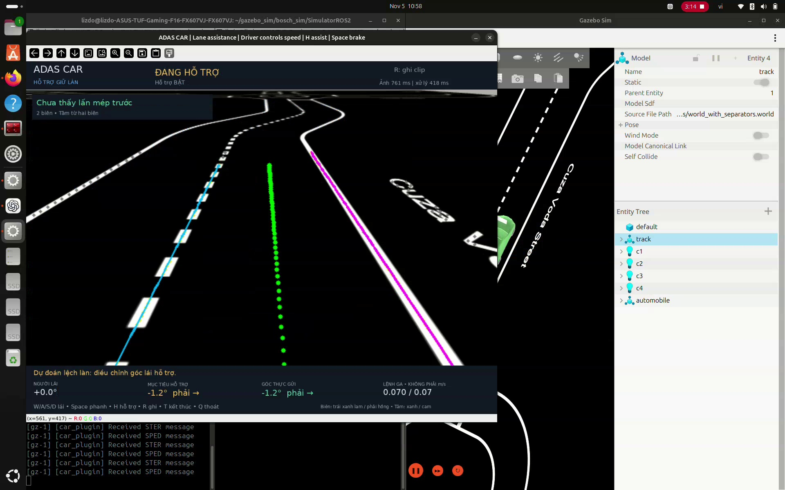

# Demo ADAS trong Gazebo

[Xem hoặc tải video đầy đủ — adas_sim.mp4](videos/adas_sim.mp4)

Video quay màn hình dài khoảng 4 phút 55 giây, ngày 05/11/2026. Minh họa giao diện ADAS hình học/OpenCV trong Gazebo; không phải thử nghiệm xe thật.

## Theo dõi làn — khoảng 01:37

## Hỗ trợ lái — khoảng 03:14

Ảnh trích trực tiếp từ video, giữ nguyên giao diện và thông số. Trong các khung này, lệnh ga hiển thị 0.07 (không phải m/s). Ảnh minh họa trạng thái giao diện, không thay thế đánh giá định lượng thuật toán.

[Thông tin video](videos/README.md). Clip ghi mới từ giao diện vẫn được lưu cục bộ trong `simulation/basic_autonomy/predictions/adas/clips/`.
